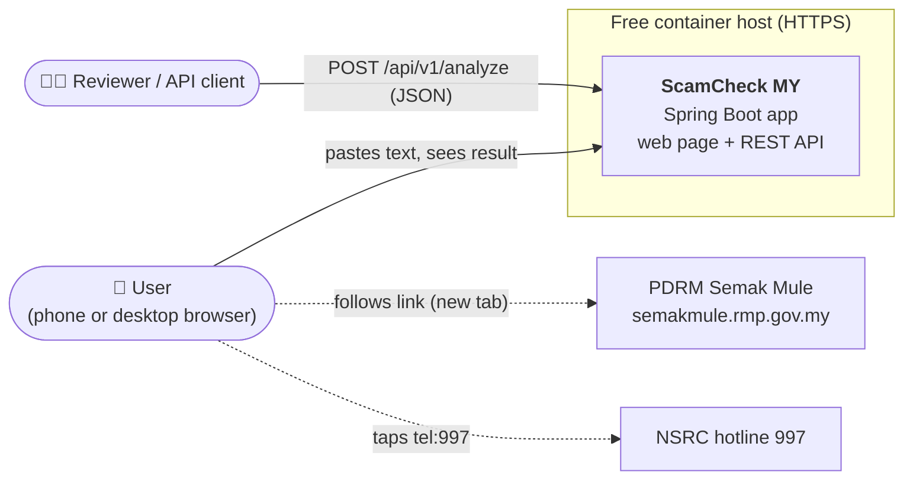
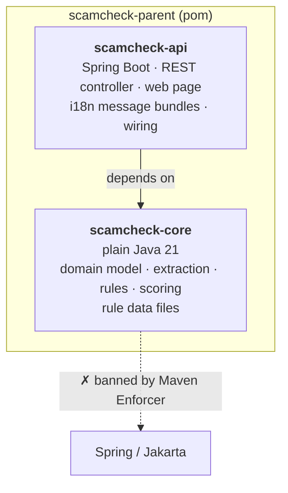
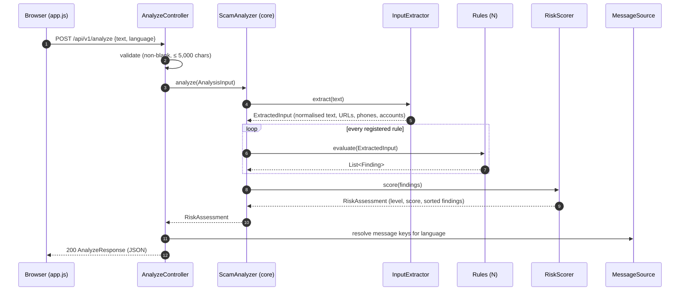
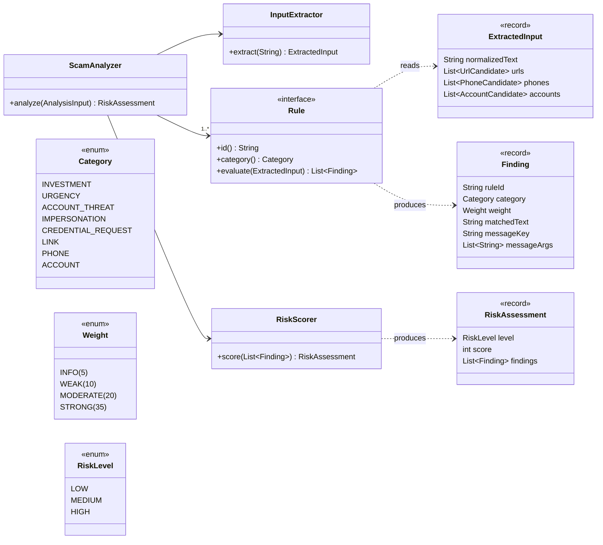

# ScamCheck MY — Architecture (v1)

| | |
|---|---|
| **Status** | Draft v1.0 — for review |
| **Author** | Azlan |
| **Last updated** | 2026-11-24 |
| **Related** | [SRS](SRS.md) · [ADRs](adr/) · [API spec](api/openapi.yaml) · [Wireframe](WIREFRAME.md) |

This document shows **how** version 1 meets the [SRS](SRS.md). Each significant choice links to the ADR that records why it was made.

---

## 1. System context

ScamCheck MY is a single stateless service. It has no database and calls no external system when it analyses input. Government services are only **linked to** from the results page. They are never queried or scraped (Project Plan §4).



Dashed arrows are links the **user** follows. The app itself never contacts these services.

---

## 2. Module layout

Two Maven modules under one parent. Dependencies point inwards only. See [ADR-003](adr/003-spring-boot-thin-adapter.md) and [ADR-004](adr/004-framework-free-core-module.md).



```
scamcheck-my/
├── pom.xml                         parent: Java 21, Spring Boot BOM, enforcer rules
├── scamcheck-core/
│   └── src/
│       ├── main/java/my/scamcheck/core/
│       │   ├── model/              AnalysisInput, ExtractedInput, Finding, Category, Weight, RiskLevel, RiskAssessment
│       │   ├── extract/            InputExtractor + URL, phone and account extractors
│       │   ├── rule/               Rule interface + one class per rule
│       │   ├── rule/data/          loaders for the rule data files
│       │   ├── score/              RiskScorer
│       │   └── ScamAnalyzer.java   the engine's single entry point
│       ├── main/resources/rules/   keyword lists, bank domains, shorteners, TLDs (ADR-007)
│       └── test/resources/samples/ scam and legitimate sample sets (ADR-007)
└── scamcheck-api/
    └── src/main/
        ├── java/my/scamcheck/api/  ScamCheckApplication, AnalyzeController, DTOs, error handler, RuleConfig
        └── resources/
            ├── messages_en.properties, messages_ms.properties   (ADR-009)
            └── static/              index.html, app.js, app.css, i18n/*.json   (ADR-006)
```

**Why only two modules:** the core holds everything worth testing. The API is a thin adapter. A separate `web` module for one static page would add build complexity with no benefit (YAGNI). A future CLI or chat bot would be a third adapter module that depends on `scamcheck-core`.

---

## 3. Request flow



Nothing in this flow writes to disk, a database or a log line that contains the input ([ADR-008](adr/008-privacy-stateless-no-input-logging.md)).

---

## 4. Core domain model

All model types are immutable Java `record`s or `enum`s.



### 4.1 The rule interface

```java
package my.scamcheck.core.rule;

/**
 * One self-contained check. Implementations must be stateless,
 * thread-safe and side-effect free: no I/O, no logging of input.
 */
public interface Rule {

    /** Stable ID used in the API and in messages, e.g. "keyword.urgency" or "link.lookalike-bank". */
    String id();

    /** Category used by the scorer to group findings. */
    Category category();

    /** Returns zero or more findings. Never returns null. */
    List<Finding> evaluate(ExtractedInput input);
}
```

Why it looks like this ([ADR-002](adr/002-pluggable-rule-engine.md)):

- **Extraction happens once, before any rule runs.** URL, phone and account detection is done by `InputExtractor`, so link rules receive parsed URLs and don't each re-scan the text. The extractor also enforces "a phone number isn't also an account number" (SRS US-06 AC3).
- **Rules know nothing about scoring.** A rule says *what* it found and *how strong* the sign is (`Weight`). The `RiskScorer` decides what that adds up to. Weights can be tuned without touching rule logic.
- **Rules know nothing about language.** They return a `messageKey` plus arguments. The API module turns that into EN or BM text ([ADR-009](adr/009-localisation-message-keys.md)).
- **Open/closed.** Adding a rule means one new class plus one line of wiring. The engine and the other rules don't change (NFR-06).

### 4.2 Planned v1 rules

| Rule ID | Category | Story | Typical weight |
|---|---|---|---|
| `keyword.investment` | INVESTMENT | US-03 | WEAK to STRONG (per phrase) |
| `keyword.urgency` | URGENCY | US-03 | WEAK to MODERATE |
| `keyword.account-threat` | ACCOUNT_THREAT | US-03 | MODERATE to STRONG |
| `keyword.impersonation` | IMPERSONATION | US-03 | MODERATE |
| `keyword.credential-request` | CREDENTIAL_REQUEST | US-03 | STRONG |
| `link.lookalike-bank` | LINK | US-04 | STRONG |
| `link.shortener` | LINK | US-04 | MODERATE |
| `link.unusual-tld` | LINK | US-04 | WEAK |
| `link.raw-ip` | LINK | US-04 | MODERATE |
| `link.not-https` | LINK | US-04 | WEAK |
| `phone.invalid-my` | PHONE | US-05 | MODERATE |
| `phone.international` | PHONE | US-05 | WEAK |
| `account.detected` | ACCOUNT | US-06 | INFO |

The five keyword rules share one implementation (`KeywordRule`), configured from a different data file each ([ADR-007](adr/007-rule-data-and-sample-sets.md)).

### 4.3 Scoring

Full reasoning is in [ADR-005](adr/005-scoring-model.md). In short:

1. **Per category, only the strongest finding counts.** Five urgency words still count as one urgency sign.
2. **Score** = the sum of those per-category maximums.
3. **Level:** score < 25 → Low · 25–59 → Medium · ≥ 60 → High.
4. **High needs at least two different categories.** One very strong sign on its own is capped at Medium (R2, SRS US-02 AC3).
5. **Account-only results are capped at Medium** (SRS US-06 AC4). `INFO` weight keeps them Low unless something else fires.

Worked examples (with the v1 starting weights):

| Input | Counted findings | Score | Level |
|---|---|---|---|
| "Jom makan, untung la dapat diskaun" | investment WEAK 10 | 10 | Low |
| "Akaun anda dibekukan, hubungi segera" | account-threat STRONG 35 + urgency MODERATE 20 | 55 | Medium |
| "Pelaburan dijamin untung 30%, daftar segera di maybank2u-secure.xyz" | investment STRONG 35 + urgency MODERATE 20 + link STRONG 35 | 90 | High |
| `https://maybank2u-secure.xyz/login` alone | link STRONG 35 (lookalike) | 35 | Medium |

Weights and thresholds are starting values. They get tuned in Phase 5 against the sample sets until NFR-02 and NFR-03 pass.

---

## 5. Cross-cutting concerns

| Concern | Approach | Reference |
|---|---|---|
| Privacy | No persistence layer at all. Input never logged. A test captures log output during analysis and fails if a canary string appears. | ADR-008, SRS US-10 |
| Input limits | Bean Validation on the request DTO: not blank, ≤ 5,000 chars. Server request size also capped. | SRS US-01 |
| Errors | RFC 9457 `application/problem+json` via Spring's `ProblemDetail`. Error bodies never echo the input. | API spec |
| Localisation | Core returns message keys. API resolves them with `MessageSource` (`messages_en`, `messages_ms`). A test checks every key exists in both bundles. | ADR-009, SRS US-09 |
| Security | No input is fetched, executed or rendered as HTML. The page inserts text with `textContent`, never `innerHTML`. Strict Content-Security-Policy header. | NFR-05 |
| Performance | Pure in-memory work. Regexes precompiled once at startup. Rule data loaded once. | NFR-01 |
| Observability | Spring Boot Actuator `/actuator/health` for the host's health check. Request metrics without bodies. | Phase 7 |
| Deployment | One Docker image (layered Spring Boot jar on a JRE 21 base). | NFR-08, Phase 6 |

---

## 6. What is deliberately not here

- No database, cache or message queue: nothing is stored (ADR-008).
- No calls to third-party APIs, domain reputation services or government sites.
- No ML or LLM classification: every result must be explainable rule by rule (G3).
- No front-end framework or Node build: one static page ([ADR-006](adr/006-static-web-ui.md)).
